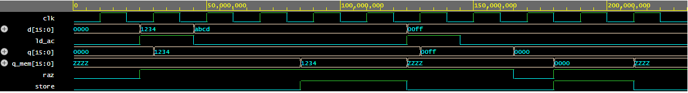

# Conception d'un processeur simple en VHDL

TP de conception numérique (BUT GEII, 2023–2024) réalisés sous **Quartus II 13.0**, pour un FPGA
**Altera Cyclone II** (EP2C20F484C7). Ils décrivent en VHDL les briques d'un processeur simple,
validées en simulation.

## Contenu

| Fichier | Description |
|---|---|
| `processeur/alu.vhd` | Unité arithmétique et logique 16 bits à 8 opérations |
| `processeur/registre_ac.vhd` | Registre accumulateur 16 bits avec remise à zéro et sortie trois états |
| `processeur/tb_registre_ac.vhd` | Banc de test du registre accumulateur, avec vérifications automatiques |
| `initiation-quartus/` | Premier projet Quartus : multiplexeur, demi-additionneur et bascules D |

## Unité arithmétique et logique (ALU)

L'opération est choisie par l'entrée `fc_ctrl` sur 3 bits :

| `fc_ctrl` | Opération |
|---|---|
| `000` | A + B |
| `001` | A − B |
| `010` | A ET B |
| `011` | A OU B |
| `100` | A = B (résultat 1 ou 0) |
| `101` | A > B (résultat 1 ou 0) |
| `110` | A < B (résultat 1 ou 0) |
| `111` | A OU exclusif B |

Les comparaisons traitent A et B comme des nombres **non signés**. Les indicateurs d'état
(zéro, retenue, négatif, dépassement) ne sont pas encore implémentés dans cette version.

## Registre accumulateur

- `RAZ` remet le registre à zéro immédiatement (asynchrone, actif à l'état bas).
- `ld_AC` charge la donnée `D` au front montant de l'horloge.
- `Q` donne en permanence le contenu du registre.
- `Q_mem` présente ce contenu sur le bus mémoire quand `store = '1'`, et passe en haute
  impédance (`Z`) sinon, pour ne pas perturber les autres composants reliés au bus.

### Simulation

Le banc de test `tb_registre_ac.vhd` applique une séquence de stimuli et vérifie
automatiquement les résultats avec des assertions. Simulation réalisée avec GHDL :

- **Vers 30 ns** : au front d'horloge, avec `ld_AC = '1'`, le registre charge `1234`.
- **De 45 à 125 ns** : `D` passe à `ABCD` sans chargement, et `Q` conserve `1234`.
- **De 85 à 125 ns** : avec `store = '1'`, `Q_mem` présente `1234` sur le bus, puis repasse à `ZZZZ`.
- **Vers 130 ns** : nouveau chargement, `Q` passe à `00FF`.
- **À 165 ns** : `RAZ` passe à 0 et `Q` revient à `0000` immédiatement, sans attendre l'horloge.

Pour la reproduire en ligne, sur EDA Playground : choisir VHDL et GHDL, coller `registre_ac.vhd`
côté *design* et le banc de test côté *testbench*, indiquer `tb_registre_AC` comme entité de plus
haut niveau, puis lancer la simulation.

## Projet d'initiation

`MIC1` sélectionne une entrée parmi deux (`sel`), l'additionne à `B` avec un demi-additionneur,
puis mémorise la somme et la retenue dans deux bascules D. Le projet s'ouvre directement avec
`MIC1.qpf`, et `Waveform1.vwf` contient les stimuli de simulation.

## Revue du code

Le code a été relu et amélioré après les TP : comparaisons de l'ALU, liste de sensibilité
complète, bibliothèque standard `numeric_std`, chargement du registre uniquement sur front
d'horloge, et projet Quartus qui s'ouvre sans chemin absolu.

## Auteur

Kayilan Mmadi Moilime
